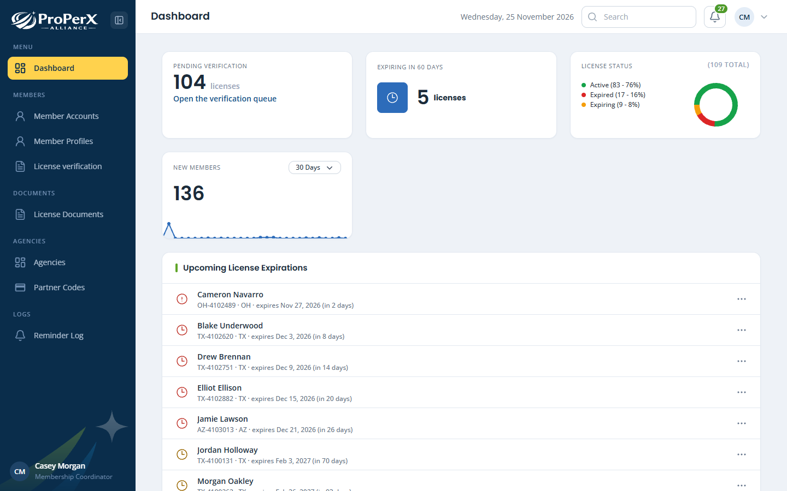
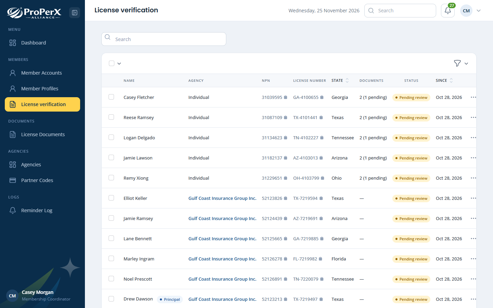
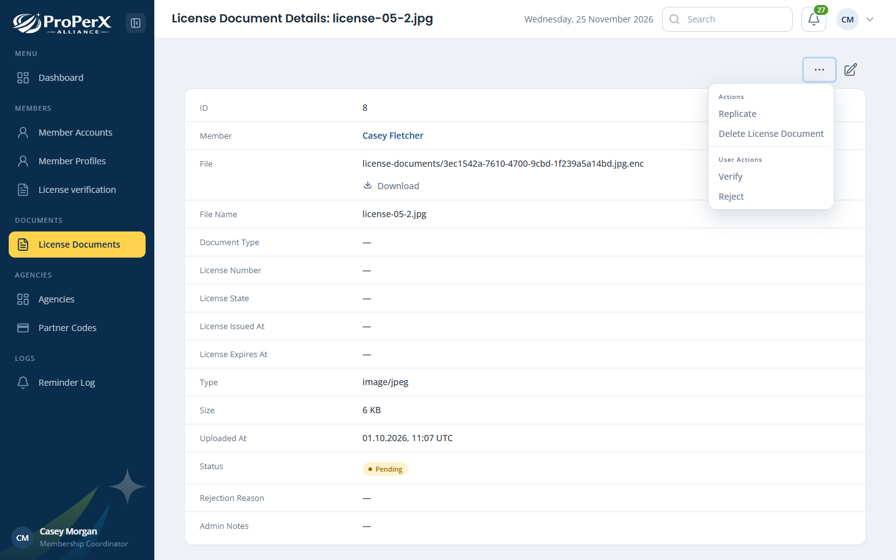
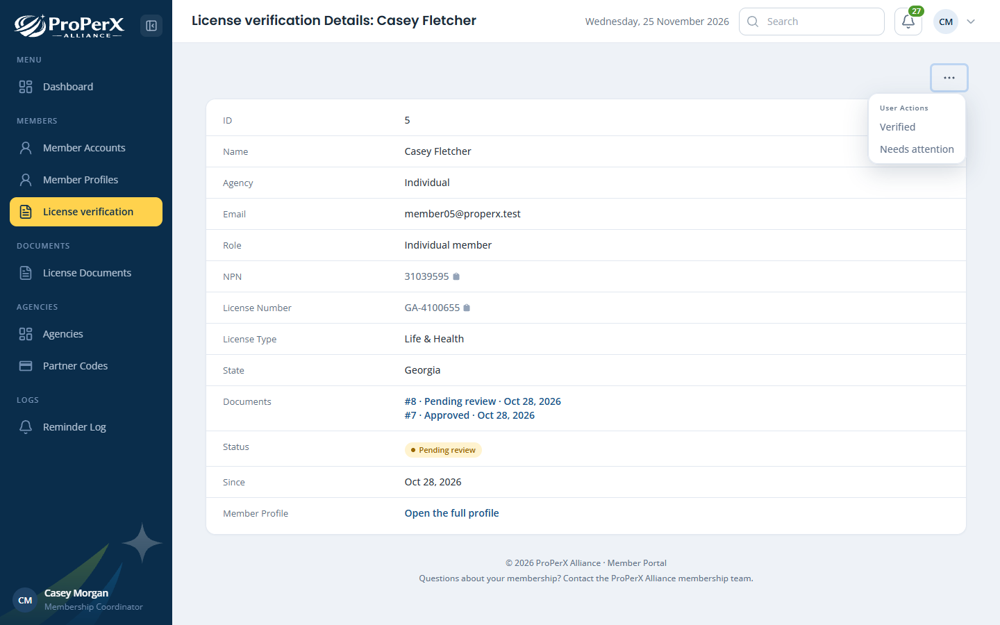
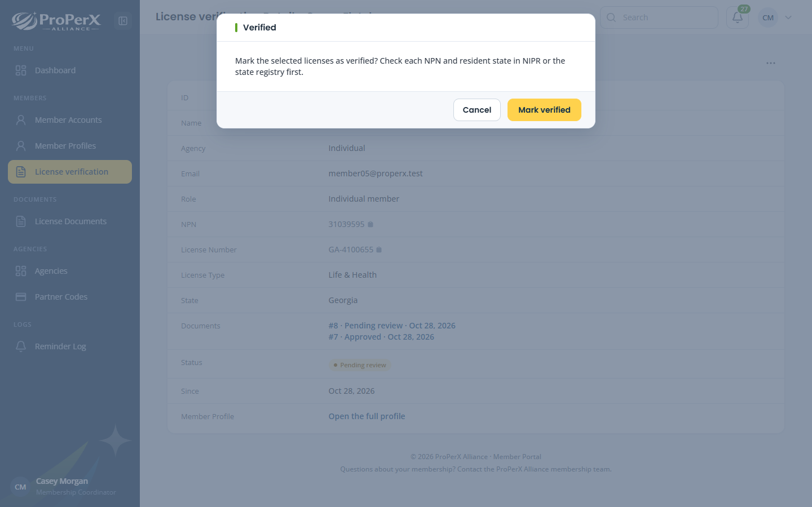
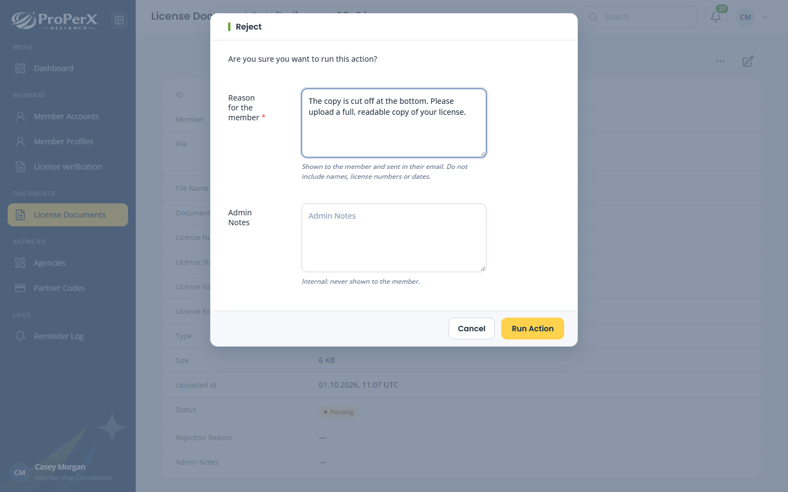
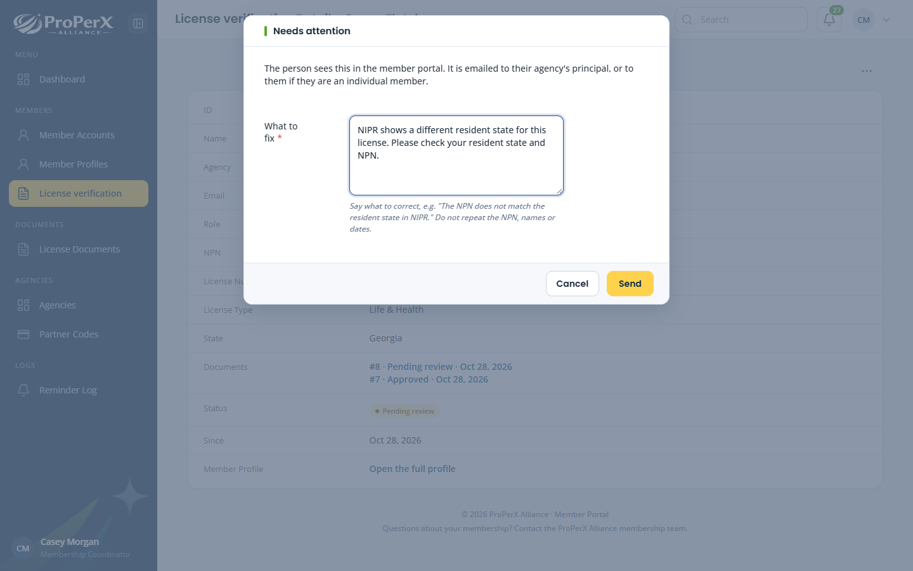
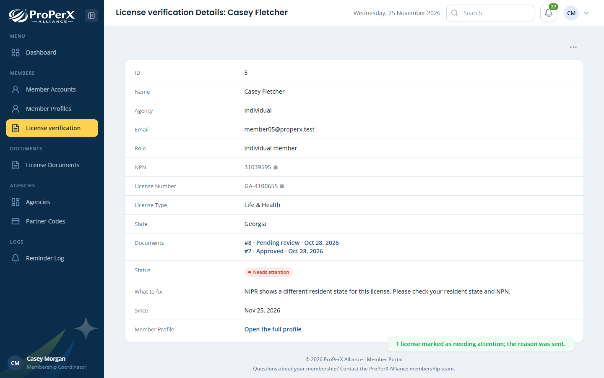
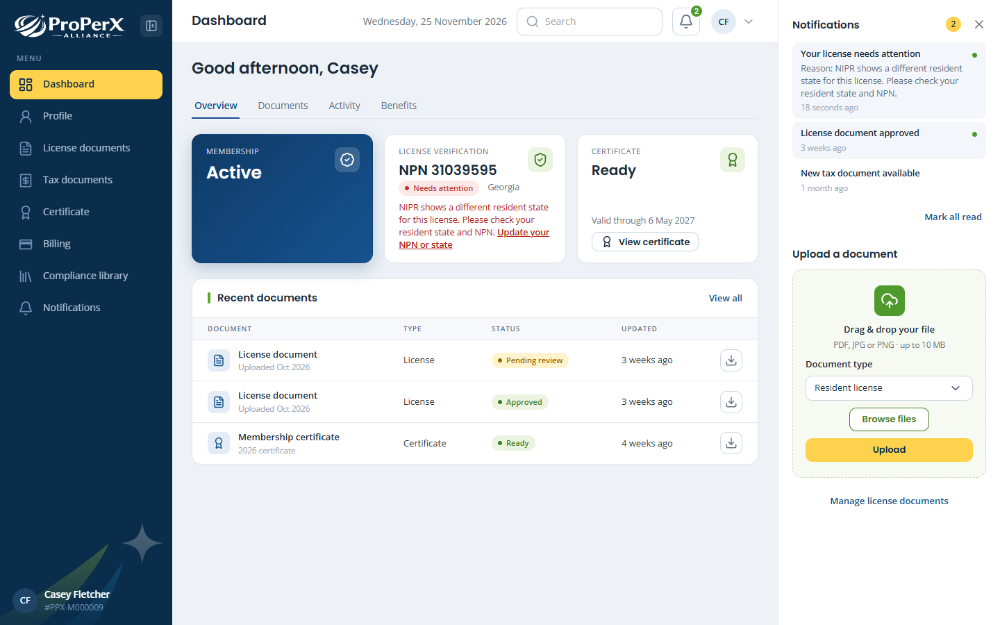

# Approving or declining a member's license

For the Membership Coordinator and the Executive Director. This is how to check a new member's license in the
member portal and then approve it or ask the member to fix it.

## Before you start

Each member has two things to check:

| What | Where in the portal | Approve | Decline |
|---|---|---|---|
| The **license copy** the member uploaded (PDF or photo) | Documents > **License Documents** | **Verify** | **Reject**, with a reason for the member |
| The member's **license details** (NPN, license number, resident state) | Members > **License verification** | **Verified** | **Needs attention**, with what to fix |

A member is approved when both are approved.

Declining does not cancel the membership or refund the payment. The member keeps using the portal while you wait
for the fix. Cancellations and refunds are handled in Stripe and on properx.org, as today.

## Find who is waiting

1. Sign in at **https://portal.properx.org/nova** with your email, your password and the code from your
   authenticator app.
2. On the **Dashboard**, the **Pending verification** card shows how many licenses are waiting. Click **Open the
   verification queue**. You can also use the menu: **Members > License verification**.

   

3. The list shows **Pending review** people first, oldest first. The **Documents** column shows how many license
   copies each person has uploaded and how many are still pending. The bell at the top also tells you when a member
   uploads a license.

   

## Check the license

4. Click the eye icon at the end of a row to open the person. Note the NPN, license number, license type and
   resident state.
5. Under **Documents**, click the pending document (for example "#8 · Pending review") to open the license copy.
   Click **Download** to view the file.
6. Look the license up in NIPR or the state's license registry. Compare the name, NPN, license number, resident
   state, license types and expiry date with the copy and with the member's details.

## Approve

7. **The license copy.** On the document page, click **⋯** (top right) and choose **Verify**. Click **Run Action**.
   The member gets an email and a portal notice: "License document approved".

   

8. **The license details.** Go back to the person (Members > License verification). Click **⋯** and choose
   **Verified**, then **Mark verified**. The status changes to **Verified**, and the member sees it on their
   dashboard. No email is sent for this step.

   

   

   To approve several people at once, tick them in the list, then choose **Verified** from the actions menu above
   the list.

## Decline

9. **The copy is unreadable, incomplete or not a license.** On the document page, click **⋯** and choose **Reject**.
   Write the **Reason for the member**: they see it in the portal and in their email. Do not include names,
   license numbers or dates. **Admin Notes** are for staff only and are optional. Click **Run Action**.
   The member gets an email and a portal notice. Their new upload comes back to the list as pending.

   

10. **The details do not match NIPR** (wrong NPN, wrong resident state, expired license). On the person, click **⋯**
    and choose **Needs attention**. Write **What to fix**, for example "NIPR shows a different resident state for
    this license. Please check your resident state and NPN." Do not repeat the NPN, names or dates. Click **Send**.
    This works for one person at a time.

    

    The status changes to **Needs attention** and your reason is shown on the person's page.

    

    Who is told:
    - an individual member, and an agency's principal about their own license: by email, in their notices and on
      their dashboard;
    - a person on an agency: in their notices and on their dashboard; the agency's principal gets the email.

    

11. When the member corrects their NPN or resident state, or uploads a new copy, the person goes back to **Pending
    review** without any action from you. Check them again from step 4.

## Good to know

- Agency employees (non-licensed staff of an agency) have no license to check and do not appear in the list.
- Use the **Status** filter (the funnel icon above the list) to see people marked **Needs attention** or
  **Verified**.
- Every decision is saved in the audit log with who made it and when. The Executive Director can view it under
  **Logs > Audit Log**.
